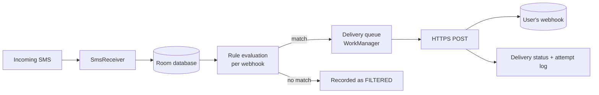

# 01 · Overview

> **Purpose:** describe what SMS Webhook is, who it is for, what is in and out of scope, and the vocabulary
> used across the rest of the documentation.

## 1. Product summary

SMS Webhook is an Android application that receives SMS messages on the user's phone and forwards selected
messages to one or more HTTP endpoints ("webhooks") that the user configures. Each webhook has its own
filtering rules, request format, headers and retry policy. The phone's local database is the source of truth:
every message is persisted before any network activity, so messages are never lost when the device is offline.

## 2. Typical use cases

| Use case | Example configuration |
|---|---|
| Payment reconciliation | Forward bank credit/debit alerts (`Sender contains HDFC` AND `Message contains any of credited, debited`) to an accounting backend, with the amount extracted by regex |
| OTP relay for testing | Forward messages matching `\b\d{6}\b` to a QA system so automated tests can read one-time passwords |
| CRM logging | Forward every SMS from a business number to a CRM with custom JSON field names |
| Workflow automation | Post messages to automation platforms that accept webhooks (e.g. n8n, Zapier, Make) |

## 3. Scope

### In scope (1.0.0)
- Receive SMS (including multipart and Unicode) on single- and dual-SIM phones.
- Unlimited webhooks; each enabled/disabled, edited, duplicated, tested and deleted independently.
- Rule engine with AND / OR / NOT over sender, message, keywords, regex, SIM slot, subscription,
  message length and time of day.
- Payload formats: JSON (field map), custom JSON template, raw text, form data; regex extraction.
- Reliable background delivery with retries, offline queueing and duplicate prevention.
- Message history, per-delivery status, attempt logs, manual retry.
- Retention by age or count; log retention; configuration export/import.
- Secret header values encrypted with the Android Keystore.

### Out of scope (non-goals)
- **Acting as an SMS client.** The app does not send, read the existing inbox, or delete SMS
  (see [17 · Known limitations](17-known-limitations.md)).
- MMS, RCS and chat-app messages.
- A cloud service operated by Best Caller. The developer runs no server that receives user messages.
- HTTP methods other than POST (the design allows adding them; see [ADR-0006](adr/0006-http-method-extensibility.md)).

## 4. Target users

Small businesses, developers and operations teams who need SMS content in their own systems. The app is
intended for users aged 18 and over.

## 5. Status

| Area | Status |
|---|---|
| Android app 1.0.0 | Feature-complete; tested on a Samsung Galaxy A17 (Android 16) |
| Release build | Signed AAB/APK in `release_item/2_release_v1.0.0/` |
| Store listing and Play forms | Written (`release_item/3_store_listing/`, `release_item/5_play_console_forms/`) |
| Store graphics, promo video, website | Done — see [13](13-build-and-release.md) and [14](14-website.md); website not yet published (DNS pending) |
| Google Play publication | Not yet submitted; requires the SMS permission declaration ([13 §7](13-build-and-release.md#7-google-play-submission)) |

## 6. Key terms

See the full [glossary](glossary.md). The most important terms:

| Term | Meaning |
|---|---|
| **Webhook** | A user-configured HTTP endpoint plus its rules, headers, payload format and retry settings |
| **Delivery** | One message being sent to one webhook (a message matching three webhooks has three deliveries) |
| **Attempt** | One HTTP request made for a delivery; a delivery may have several attempts |
| **Filtered** | A message that did not match a webhook's rules; recorded, never sent to that webhook |
| **Fingerprint** | SHA-256 identity of an SMS used to ignore duplicate broadcasts |
