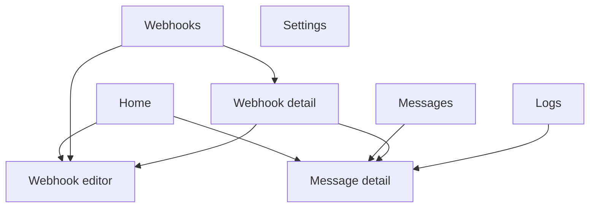

# 02 · User guide

> **Purpose:** describe every screen and workflow as the user experiences it. Labels in **bold** match the
> app exactly. The public, illustrated version of this guide is published at
> https://smswebhook.bestcallerapp.com/guide/.

## 1. Navigation

The app has five top-level destinations in a bottom navigation bar, plus detail screens that open on top.

| Tab | Purpose |
|---|---|
| **Home** | Service status, counters, recent messages |
| **Messages** | Full, searchable message history |
| **Webhooks** | Create and manage webhooks |
| **Logs** | Every HTTP attempt, newest first |
| **Settings** | Listener, retention, delivery defaults, logs, privacy, about |

## 2. First run

1. Open the app. The **Home** screen shows a red **SMS permission required** card.
2. Tap **Grant permission** and allow **SMS**. The card disappears and the status changes to **Service active**.
3. If the permission was denied permanently, the card offers **Open app settings**. On Android 13 and later,
   apps installed outside Google Play may first need **App info → ⋮ → Allow restricted settings**.
4. If **Battery optimisation is on** appears, tap **Battery settings** and set the app to *Unrestricted*
   (recommended on Samsung, Xiaomi, Oppo, Vivo and similar devices).
5. Add a webhook (§5). Until then, incoming SMS are stored and marked **Filtered**.

## 3. Home

| Element | Description |
|---|---|
| **Service active / Service inactive** | Active only when forwarding is on **and** the SMS permission is granted |
| **SMS listener** | **Active**, **No permission** or **Stopped** |
| **Internet** | **Connected**, or **Offline — deliveries will resume automatically** |
| **Forward incoming SMS** | Master switch. Off disables the SMS receiver component; incoming SMS are ignored |
| Counters | **Messages**, **Delivered**, **Pending**, **Failed**, **Webhooks** (enabled / total) |
| **Recent messages** | Last five messages with status; **View all** opens Messages |

## 4. Messages and message detail

**Messages** lists all stored messages, newest first, loaded page by page.

- **Search** matches sender and message text.
- Filter chips: **All**, **Delivered**, **Failed**, **Pending** (includes received, sending and retrying),
  **Filtered**.

Tapping a message opens **Message detail**:

| Section | Content |
|---|---|
| Message | Full text (selectable), **Sender**, **Sent (SMSC)**, **Received**, **SIM**, **Subscription**, **Parts**, **Message ID**, **Fingerprint** |
| **Webhooks (n)** | One card per webhook: status, **Attempts**, **HTTP status**, **Last attempt**, **Next attempt** (when retrying), **Error**. **Show details** reveals the exact request body and the response. **Retry** appears on failed deliveries |
| **Delivery attempts** | Every HTTP attempt for this message |
| Delete (toolbar) | Removes the message and its delivery history from the app only. The SMS in the phone's messaging app is unaffected |

### Status values

| Message status | Meaning |
|---|---|
| **Received** | Stored; rules not yet evaluated (normally lasts a moment) |
| **Pending** | At least one delivery is waiting to be sent |
| **Sending** | A delivery is in progress |
| **Retrying** | A delivery failed temporarily and is scheduled again |
| **Delivered** | Every matching webhook accepted the message (HTTP 2xx) |
| **Failed** | At least one delivery failed permanently or ran out of retries |
| **Filtered** | No enabled webhook matched |

## 5. Webhooks

The **Webhooks** list shows a card per webhook: name, URL, **Enabled/Disabled**, scope (**All messages** or
**Filtered**), delivered/failed/pending counts and actions **Edit**, **Test** and **⋮** (**Duplicate**,
**Delete**). The switch enables or disables the webhook. **Add webhook** starts the editor.

### 5.1 Webhook editor (7-step wizard)

| Step | Title | What you configure |
|---|---|---|
| 1 | **Webhook** | **Webhook name**, **Webhook URL** (HTTPS required in release builds). Method is POST |
| 2 | **Headers & authentication** | Quick actions **Bearer token**, **Basic auth**, **API key header**; any custom header; **Secret (encrypt and hide)** per header |
| 3 | **Message filters** | **All messages** or **Only matching messages**, then conditions and groups (see [06](06-filter-engine.md)). **Test regex** on regex conditions |
| 4 | **Payload** | **Body format**: **JSON**, **Custom JSON template**, **Raw text**, **Form data**; fields and their names, or the template |
| 5 | **Regex extraction** | Named values pulled from the message with a regex and capture group |
| 6 | **Retry & timeout** | **Timeout (seconds)**, **Maximum retries**, **First retry delay (seconds)** |
| 7 | **Review** | Summary of every step with **Edit** links, **Enable webhook**, **Send test request**, **Save webhook** |

- **Try it with a sample SMS** (steps 3–5) evaluates the draft live: whether the sample *Would be forwarded*,
  the exact **Request body preview**, and each extracted value.
- **Next** validates the current step; problems are shown next to the field. **Save webhook** validates
  everything and jumps to the first step with a problem.
- The draft survives the app being closed by the system mid-edit. Secret values of a *new* webhook must be
  re-entered in that case.
- Closing with **✕** or Back on step 1 asks **Discard changes?**

### 5.2 Webhook detail

Shows the full configuration, counters, an enable switch, **Test webhook**, **Retry failed** (re-queues every
failed delivery for this webhook) and the paged **Delivery history** with **All / Failed** filters. Toolbar:
**Edit**, **Duplicate**, **Delete**.

### 5.3 Test webhook

Sends a sample message (sender `TEST`, text "This is a test SMS", or the sample SMS from the editor) using the
webhook's real headers and payload format. The result dialog shows **Test succeeded/failed**, **HTTP status**,
**Response time**, **Error**, the request body and the response body. Tests are not stored as deliveries.

## 6. Logs

Every HTTP attempt: webhook name, method and URL (query values redacted), outcome (**Success**, **Will retry**,
**Failed**), **Status**, **Attempt**, **Duration**, **Time**, **Error**, and **Open message**. Filters:
**All**, **Successful**, **Failed**. The toolbar action clears all logs. Header values are never logged.

## 7. Settings

| Section | Items |
|---|---|
| **SMS** | **SMS listener**; **SIM handling** (information); **Delete SMS after forwarding** (disabled — see [17](17-known-limitations.md)) |
| **History** | **Retention**: by age (7 / 30 / 365 days), by count (100 / 1,000 / 10,000 / 100,000 / custom) or forever; **Clear history** |
| **Delivery** | Defaults for new webhooks: **Default retry count**, **Default retry delay**, **Default timeout**; **Only on Wi-Fi** |
| **Logs** | **Keep delivery logs**, **Log retention** (7 / 30 / 90 / 365 days), **Clear logs** |
| **Reliability** | **Battery optimisation** status and shortcut; **App permissions** |
| **Privacy & data** | **Local data**, **Data encryption** (information); **Export configuration**; **Import configuration**; **Clear all application data** |
| **About** | **How-to guide**, **Privacy policy**, **Terms of use**, **Contact support**, **Website**, **Version** |

### Export and import
- **Export configuration** writes a JSON file through the system file picker. Secrets are excluded unless
  you choose **Include secret header values** and confirm a plain-text warning.
- **Import configuration** adds the webhooks from a file as new, **disabled** webhooks. Missing secrets are
  flagged for re-entry. Format: [10 §4](10-configuration-reference.md#4-configuration-export-format).
