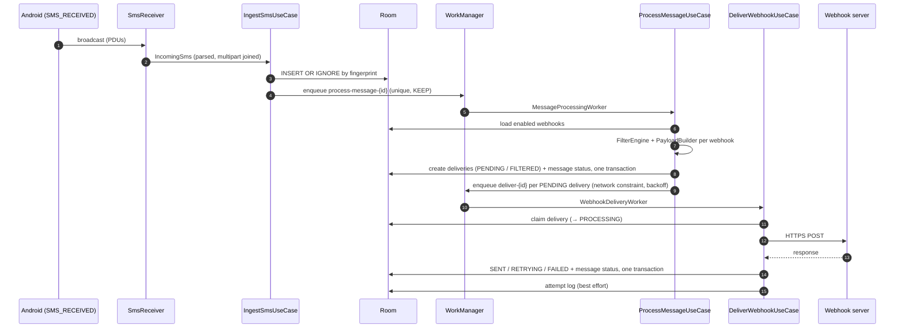

# 04 · Architecture

> **Purpose:** explain how the application is structured, how a message flows through it, and which component
> owns which responsibility. Design rationale is recorded in the [ADRs](adr/README.md).

## 1. Architectural style

Clean architecture with a pure-Kotlin domain at the centre and Android-specific code at the edges.
Dependencies point inwards.

```mermaid
flowchart LR
    subgraph Android entry points
      RCV[receiver/SmsReceiver]
      WRK[worker/*Worker]
      UI[presentation/ Compose + ViewModels]
    end
    subgraph Domain (pure Kotlin)
      UC[usecase/]
      ENG[engine/]
      MOD[model/]
      PORT[port/ + repository/ interfaces]
    end
    subgraph Data (implementations)
      ROOM[Room DAOs]
      HTTP[OkHttpWebhookSender]
      DS[DataStore settings]
      SYS[Keystore, WorkManager, PackageManager adapters]
    end
    RCV --> UC
    WRK --> UC
    UI --> UC
    UC --> ENG
    UC --> PORT
    ENG --> MOD
    ROOM -. implements .-> PORT
    HTTP -. implements .-> PORT
    DS -. implements .-> PORT
    SYS -. implements .-> PORT
```

| Layer | May depend on | Must not depend on |
|---|---|---|
| `domain` | Kotlin stdlib, coroutines, kotlinx.serialization-json, paging-common (`PagingData` type only) | Android framework, Room, OkHttp, Hilt modules |
| `data` | `domain`, Android, Room, OkHttp, DataStore | `presentation` |
| `presentation` | `domain`, Compose, lifecycle, navigation | `data` |
| `receiver`, `worker` | `domain` use cases | business rules (they only translate events into use-case calls) |

Dependency injection uses **Hilt**. `di/AppModules.kt` binds every port and repository interface to its
implementation, so domain code and tests depend only on interfaces.

## 2. Processing pipeline



| Stage | Component | Responsibility | Failure handling |
|---|---|---|---|
| Receive | `SmsReceiver`, `SmsIntentParser` | Parse PDUs, join parts, read SIM data | Parse errors are logged; nothing is stored |
| Ingest | `IngestSmsUseCase` | Fingerprint, insert-if-absent, enqueue processing | DB failure → `IngestSmsWorker` fallback via WorkManager |
| Process | `ProcessMessageUseCase` | Evaluate every enabled webhook, freeze payload, create deliveries | Worker retries up to 5 times; re-running is idempotent |
| Deliver | `DeliverWebhookUseCase` | Claim, send, classify, record, decide retry | Retry with exponential backoff; permanent failures stop |
| Recover | `ReconcileQueueUseCase` | Re-enqueue unprocessed messages and active deliveries | Runs at every app start; enqueueing is idempotent |
| Clean up | `ApplyRetentionUseCase` | Enforce message and log retention | Daily periodic work and after settings changes |

Details: [05 · SMS reception](05-sms-reception.md), [08 · Delivery and retries](08-delivery-and-retries.md).

## 3. Components

### 3.1 Domain engines (`domain/engine/`)

| Component | Responsibility |
|---|---|
| `FilterEngine` | Evaluates a webhook's filter tree against a message ([06](06-filter-engine.md)) |
| `RegexEvaluator` | Compiles, caches and evaluates user regex with a 250 ms time budget |
| `PayloadBuilder` | Renders the request body in the configured format ([07](07-payloads-and-extraction.md)) |
| `TemplateEngine` | `{{variable}}` substitution, no code execution |
| `ValueExtractor` | Applies regex extractors |
| `MessageFingerprinter` | SHA-256 identity of an SMS for duplicate detection |
| `RetryPolicy` | Retry-or-give-up decision and expected backoff |
| `DeliveryResultClassifier` | Maps an HTTP result to success / retryable / permanent |
| `MessageStatusAggregator` | Derives a message's status from its deliveries |
| `WebhookValidator` | Validates a configuration before saving or importing |
| `WebhookRequestFactory` | Builds the HTTP request (headers, content type, timeout) |
| `WebhookPreviewer` | Live previews in the editor (filters, extraction, payload, regex test) |

### 3.2 Ports (`domain/port/`)

| Port | Implementation | Purpose |
|---|---|---|
| `WebhookSender` | `OkHttpWebhookSender` | Main-safe HTTP; never throws for network errors |
| `WorkScheduler` | `WorkManagerScheduler` | Durable unique work, constraints, backoff |
| `SmsDeleter` | `AndroidSmsDeleter` | Reports deletion as unsupported (not default SMS app) |
| `SmsListenerController` | `AndroidSmsListenerController` | Permission check; enables/disables the receiver component |
| `DeviceInfoProvider` | `AndroidDeviceInfoProvider` | Device description for the optional `device` field |
| `PowerStatusProvider` | `AndroidPowerStatusProvider` | Battery-optimisation status |
| `ConfigCodec` | `JsonConfigCodec` | Export/import file format |

## 4. Threading and lifecycle

| Context | Dispatcher / scope | Notes |
|---|---|---|
| `SmsReceiver` | `@ApplicationScope` (SupervisorJob + IO) inside `goAsync()` | 6 s ingest budget; falls back to WorkManager |
| Workers | `CoroutineWorker` (WorkManager's dispatcher) | Re-throw `CancellationException`; unexpected errors → `Result.retry()` |
| HTTP | `withContext(@IoDispatcher)` inside `OkHttpWebhookSender.send` | Main-safe; covered by `MainSafetyTest` |
| ViewModels | `viewModelScope` | UI state as `StateFlow`; one-off events via `Channel` |
| Room | Room's query executors (suspend / Flow / PagingSource) | Multi-step changes use `withTransaction` |
| Editor previews | `flowOn(Dispatchers.Default)` | Regex and payload rendering off the main thread |

## 5. Consistency model

- **Source of truth:** the Room database. The UI observes it through `Flow` and `PagingData`.
- **Atomicity:** every delivery state change and the derived message status are written in one transaction
  (`DeliveryRepositoryImpl.transitionAndRecompute`). Deleting a webhook recomputes the affected messages in the
  same transaction.
- **Idempotency:** unique fingerprint, unique (message, webhook) delivery, unique work names, and an atomic
  claim mean every step can safely run more than once ([08 §3](08-delivery-and-retries.md#3-idempotency-and-duplicate-prevention)).
- **Durability:** WorkManager persists queued work across process death and reboots; `ReconcileWorker`
  repairs the gap between a database write and an enqueue.

## 6. UI architecture

- Single activity (`presentation/MainActivity`), Jetpack Compose, Material 3, light and dark themes.
- Navigation Compose with type-safe `@Serializable` routes (`presentation/navigation/Routes.kt`).
- One ViewModel per screen, exposing immutable UI state. Lists with unbounded size use Paging 3.
- The webhook editor keeps its draft in `SavedStateHandle` (secrets excluded) to survive process death.
