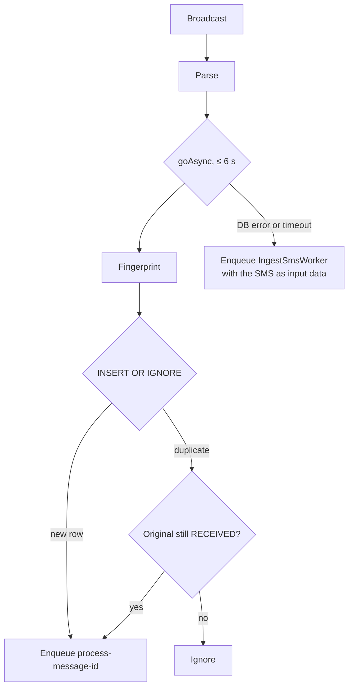

# 05 · SMS reception

> **Purpose:** specify how incoming SMS are received, parsed, de-duplicated and stored.

## 1. Receiver registration

`SmsReceiver` is declared in `AndroidManifest.xml`:

| Attribute | Value | Reason |
|---|---|---|
| Action | `android.provider.Telephony.SMS_RECEIVED` | Delivered to every app holding `RECEIVE_SMS` (not only the default SMS app) |
| `android:permission` | `android.permission.BROADCAST_SMS` | Only the telephony stack can send it; other apps cannot inject fake SMS |
| `android:exported` | `true` | Required to receive the system broadcast |
| Priority | 999 | Informational; ordering does not matter because the app does not abort the broadcast |

The **Forward incoming SMS** switch enables or disables this component through `PackageManager`
(`AndroidSmsListenerController`). When disabled, Android does not start the app for SMS at all. At every app
start the component state is re-aligned with the stored setting.

## 2. Parsing (`SmsIntentParser`)

1. `Telephony.Sms.Intents.getMessagesFromIntent(intent)` returns the PDUs of the broadcast.
2. Parts are grouped by originating address and their bodies are concatenated in order. A multipart message
   arrives in a single broadcast, so it is stored as one message with `partCount` > 1.
3. Sender: `displayOriginatingAddress` (trimmed). Body: `displayMessageBody`.
4. `sentAt`: the **service-centre timestamp** of the first PDU. `receivedAt`: the local time of handling.
5. Subscription ID: `SubscriptionManager.EXTRA_SUBSCRIPTION_INDEX`, falling back to the legacy `subscription`
   extra.
6. SIM slot (zero-based): `EXTRA_SLOT_INDEX` (Android 11+), legacy extras (`slot`, `simSlot`, `slot_id`), or
   `SubscriptionManager.getSlotIndex(subId)` (Android 10+). Unknown values are stored as `null`.

The UI and payloads present the SIM slot one-based (**SIM 1**, `"sim_slot": 1`).

## 3. Ingest



- The receiver performs **no network I/O**. It stores the message and schedules work, typically in a few
  milliseconds.
- If the direct database write fails or exceeds the 6-second budget, the SMS is passed to `IngestSmsWorker`
  through WorkManager's own storage (unique per sender/time/body), which retries up to 10 times.

## 4. Duplicate detection

Android can deliver the same `SMS_RECEIVED` broadcast more than once (for example after a process restart).
`MessageFingerprinter` computes:

```
SHA-256( "v1" ␟ upper(trim(sender)) ␟ body ␟ serviceCentreTimestamp ␟ (subscriptionId ?: -1) )
```

| Input | Included | Reason |
|---|---|---|
| Sender (normalised) | Yes | Distinguishes senders |
| Body | Yes | Distinguishes content |
| Service-centre timestamp | Yes | Part of the PDU — identical across re-delivered broadcasts |
| Subscription ID | Yes | Same text on two SIMs is two messages |
| Local receive time | **No** | Differs between re-deliveries of the same PDU, so it would defeat de-duplication |

`sms_messages.fingerprint` has a UNIQUE index and the insert uses `OnConflictStrategy.IGNORE`.
**Accepted trade-off:** two genuinely distinct SMS with the same sender, text, SIM and service-centre second
are treated as one.

The fingerprint is also exposed to webhooks as the `id` payload field.

## 5. Edge cases

| Case | Behaviour |
|---|---|
| Multipart / very long SMS | Joined into one message; `partCount` recorded |
| Unicode (Hindi, emoji, ₹) | Stored and forwarded as UTF-8; filters compare Unicode-aware |
| Dual SIM | Subscription ID and slot stored when reported; filterable by **SIM slot** |
| SIM changed | Each message records the subscription it arrived on; nothing else to update |
| No webhooks configured | Stored and marked **Filtered** |
| Forwarding switched off | Receiver disabled; SMS are not stored |
| Permission revoked | Android stops delivering broadcasts; Home shows **No permission** |
| Device restart | The receiver is manifest-declared; queued work resumes via WorkManager |
| App force-stopped | Android suppresses broadcasts until the app is opened again (platform behaviour) |
