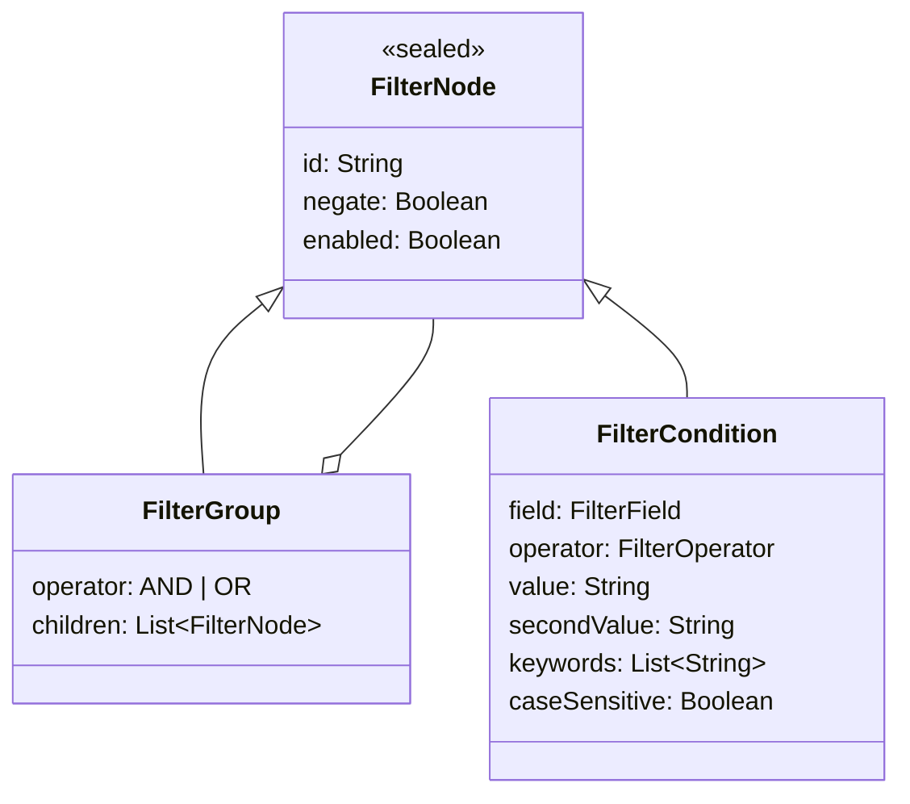

# 06 · Filter engine

> **Purpose:** define the rule model, operator semantics and evaluation behaviour of `FilterEngine`
> (`domain/engine/FilterEngine.kt`).

## 1. Scope modes

| Scope | Enum | Behaviour |
|---|---|---|
| **All messages** | `WebhookScope.ALL_MESSAGES` | Every SMS is delivered to the webhook ("common webhook") |
| **Only matching messages** | `WebhookScope.MATCHING_RULES` | The filter tree is evaluated; the SMS is delivered only if it matches |

Every enabled webhook is evaluated independently, so one SMS can match any number of webhooks.

## 2. Rule model

A filter is a tree. Each webhook has one root group.



- Groups nest up to **3 levels** (`WebhookLimits.MAX_FILTER_DEPTH`).
- Any node can be negated (**NOT**).
- Disabled nodes are ignored.
- An **empty group matches everything** (it imposes no constraint). The validator requires at least one
  enabled condition when the scope is **Only matching messages**.

## 3. Fields and operators

| Field | Value kind | Operators | Notes |
|---|---|---|---|
| `SENDER` | Text | Equals, Does not equal, Contains, Does not contain, Starts with, Ends with, Matches regex, Contains any keyword, Contains all keywords | Equals compares trimmed values |
| `MESSAGE` | Text | same as Sender | |
| `SIM_SLOT` | Number | =, ≠, >, <, Between | One-based (SIM 1, SIM 2) |
| `SUBSCRIPTION_ID` | Number | =, ≠, >, <, Between | Android subscription ID |
| `MESSAGE_LENGTH` | Number | =, ≠, >, <, Between | Counted in Unicode code points |
| `RECEIVED_TIME` | Time of day (`HH:mm`) | After (≥), Before (<), Between | Device time zone; a window may wrap midnight (22:00–06:00) |

Text operators are case-insensitive unless **Case-sensitive** is set (Unicode case folding). Keyword lists
ignore blank entries; an empty list never matches.

## 4. Evaluation semantics

```
evaluate(node)  = raw(node) XOR node.negate
raw(group)      = true                                  if no enabled children
                = all(evaluate(child))                  if AND
                = any(evaluate(child))                  if OR
raw(condition)  = operator applied to the field value   (false if it cannot be evaluated)
```

A condition that **cannot be evaluated** is `false` *before* negation. This includes: invalid regex, regex
timeout, unknown SIM slot or subscription, and an unparsable number or time.

### Examples

| Goal | Rule |
|---|---|
| HDFC credit alerts | `Sender contains HDFC` AND `Message contains credited` |
| Any of three banks | OR group: `Sender contains HDFC`, `Sender contains ICICI`, `Sender contains SBI` |
| Credits or debits | `Message contains any keyword: credited, debited` |
| Six-digit OTPs | `Message matches regex \b\d{6}\b` |
| Everything except promotions | `Sender starts with AD-` with **NOT** |
| Night messages on SIM 2 | `SIM slot = 2` AND `Time received between 22:00 and 06:00` |

## 5. Regular expressions

- Engine: `java.util.regex` with **find** semantics (the pattern may match anywhere). Use `^…$` to anchor.
- Inline flags such as `(?i)` are supported. **Case-sensitive** off adds `CASE_INSENSITIVE | UNICODE_CASE`.
- Patterns are validated when saving; the error states the problem and position.
- Compiled patterns are cached (LRU, 128 entries).
- **Catastrophic backtracking protection:** each evaluation runs on a `CharSequence` that aborts after
  **250 ms** (`AppConstants.REGEX_TIMEOUT_MS`). A pattern such as `^(a+)+$` therefore cannot stall
  processing; the condition evaluates to `false`.
- **Test regex** in the editor shows whether a sample matches, the full match and every capture group.

## 6. Persistence and compatibility

The tree is stored as versioned JSON in `webhook_filters.definition` (`schema_version` = 1) by
`FilterDefinitionCodec`. Enum values are stored as strings and decoded leniently: a field or operator unknown
to the running version (written by a newer version) is loaded **disabled**, never guessed.
