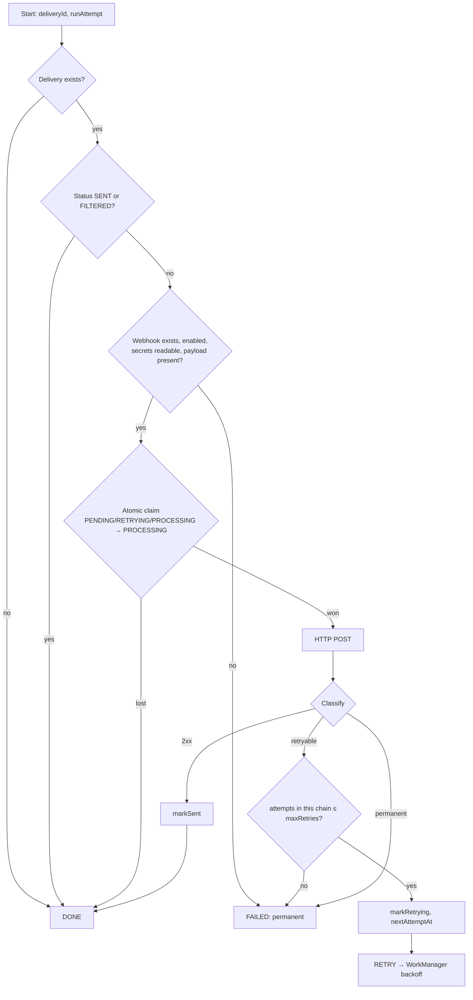
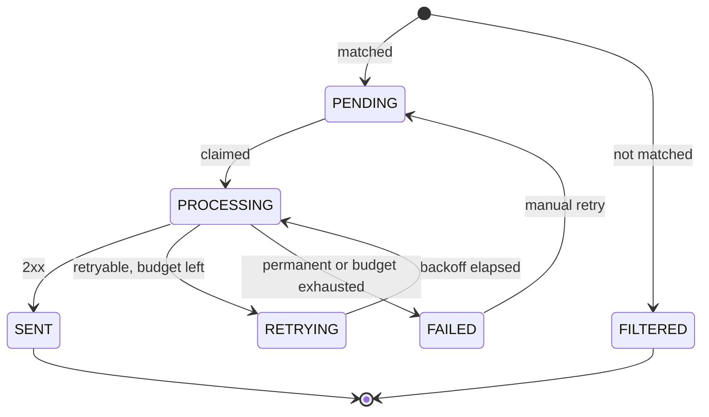

# 08 · Delivery and retries

> **Purpose:** specify scheduling, the delivery algorithm, idempotency guarantees, retry policy and the status
> model.

## 1. Scheduling (WorkManager)

| Work | Unique name | Policy | Constraints | Notes |
|---|---|---|---|---|
| `MessageProcessingWorker` | `process-message-<messageId>` | KEEP | none | Expedited (falls back to normal when quota is exhausted) |
| `WebhookDeliveryWorker` | `deliver-<deliveryId>` | KEEP (REPLACE for manual retry) | Network CONNECTED, or UNMETERED with **Only on Wi-Fi** | Expedited; EXPONENTIAL backoff from the webhook's retry delay |
| `IngestSmsWorker` | `ingest-sms-<hash>` | KEEP | none | Fallback when the receiver cannot write to the database |
| `ReconcileWorker` | `reconcile-queue` | KEEP | none | One-off at every app start |
| `CleanupWorker` (periodic) | `periodic-maintenance` | KEEP | Battery not low | Every 24 h |
| `CleanupWorker` (one-off) | `one-off-cleanup` | REPLACE | none | After retention settings change |

On Android 11 and lower, expedited work runs as a short foreground service with a silent, minimum-importance
notification (channel **Background forwarding**). On Android 12 and later no notification is shown.

Changing **Only on Wi-Fi** updates the constraints of already-queued deliveries (`WorkManager.updateWork`).

## 2. Delivery algorithm (`DeliverWebhookUseCase`)

The outcome is persisted **before** the attempt log is written. Writing the log is best-effort, so a logging
failure can never turn a successful send into a retry (which would send the message twice).

## 3. Idempotency and duplicate prevention

| Layer | Mechanism | Prevents |
|---|---|---|
| Message | UNIQUE `fingerprint`, `INSERT OR IGNORE` | Re-delivered broadcasts creating duplicate messages |
| Processing | Skips messages not in `RECEIVED`; re-queues their active deliveries | Re-processing creating new deliveries |
| Delivery rows | UNIQUE (`message_id`, `webhook_id`), `INSERT OR IGNORE` | Two deliveries of one message to one webhook |
| Work | Unique work names with KEEP | Concurrent execution of the same delivery |
| Claim | `UPDATE … WHERE status IN (active)` | Sending a delivery that is already SENT |
| Receiver side | `X-Idempotency-Key` header | Duplicates when a response is lost after the server processed the request |

**Delivery semantics are at-least-once.** If the server processes a request but the response never reaches the
phone (timeout, dropped connection), the app retries with the same idempotency key. Receivers SHOULD
de-duplicate on `X-Idempotency-Key` or the `id` field ([15](15-webhook-integration.md)).

## 4. Result classification

| Result | Outcome | Error type |
|---|---|---|
| HTTP 200–299 | Success | — |
| HTTP 408, 425, 429 | Retryable | `HTTP_CLIENT_ERROR` |
| HTTP 5xx | Retryable | `HTTP_SERVER_ERROR` |
| HTTP 3xx | Permanent (redirects are not followed) | `UNEXPECTED_REDIRECT` |
| Other HTTP 4xx | Permanent | `HTTP_CLIENT_ERROR` |
| Timeout | Retryable | `TIMEOUT` |
| DNS failure | Retryable | `DNS` |
| Connection refused/reset, transient TLS handshake I/O errors | Retryable | `CONNECTION` |
| Certificate or hostname verification failure | Permanent | `SSL` |
| Invalid URL or header | Permanent | `INVALID_URL` / `INVALID_CONFIGURATION` |
| Secret header cannot be decrypted | Permanent | `CREDENTIAL_UNAVAILABLE` |
| Webhook deleted or disabled before sending | Permanent | `WEBHOOK_REMOVED` / `WEBHOOK_DISABLED` |
| Other I/O error | Retryable | `UNKNOWN` |

## 5. Retry policy

- **Maximum retries** (0–10) = retries *after* the first attempt; total attempts ≤ maxRetries + 1.
- **First retry delay** (10–3600 s) doubles after each failure: `delay × 2^(attempt−1)`, capped at 5 hours.
  WorkManager enforces a 10-second minimum. Example (30 s): 30 s → 1 min → 2 min → 4 min → 8 min.
- The expected next attempt is shown in the UI; WorkManager owns the exact timing.
- **Offline:** delivery work waits for its network constraint, so no retry budget is consumed while the device
  has no connectivity.
- **Manual retry** (message detail, webhook detail, **Retry failed**) resets `FAILED → PENDING` and starts a
  fresh retry budget. Only failed deliveries can be retried; sent ones never are.

## 6. Status model

A message's status is derived from its deliveries, in priority order:

| Deliveries (ignoring FILTERED) | Message status |
|---|---|
| none | `FILTERED` |
| any PROCESSING | `PROCESSING` |
| any RETRYING | `RETRYING` |
| any PENDING | `PENDING` |
| any FAILED | `FAILED` |
| all SENT | `SENT` |

Messages that have not been processed yet are `RECEIVED`.

## 7. Recovery

`ReconcileQueueUseCase` runs at every app start. It re-enqueues messages still in `RECEIVED` and deliveries in
`PENDING`, `RETRYING` or `PROCESSING`. Because enqueueing is unique with KEEP, this is harmless when the work
already exists, and it repairs work lost between a database commit and an enqueue (e.g. process death).
