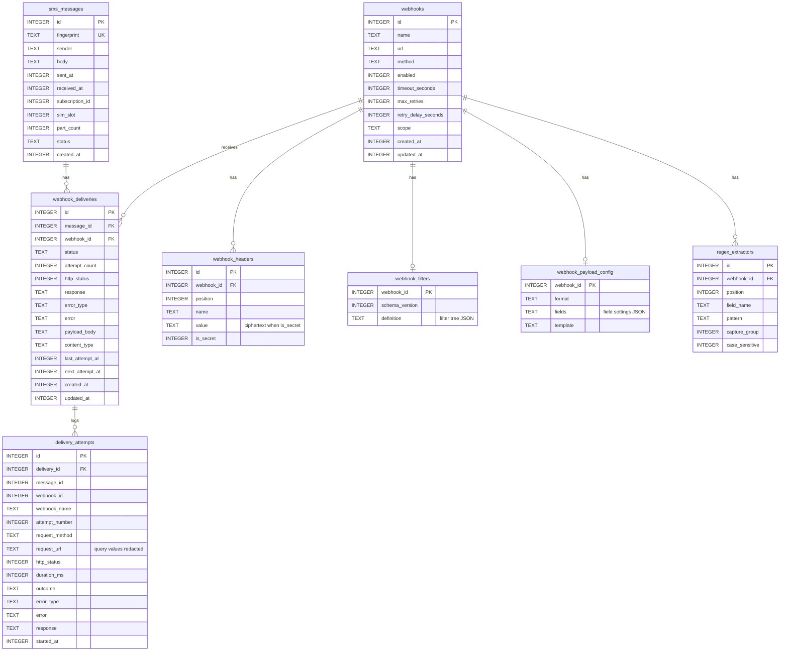

# 09 · Data model

> **Purpose:** document the persistent storage: Room schema, indexes, relationships, migrations, retention and
> the settings store.

## 1. Storage overview

| Store | Technology | File | Contents |
|---|---|---|---|
| Main database | Room (SQLite), version 1 | `databases/sms_webhook.db` | Messages, webhooks and their configuration, deliveries, attempt logs |
| Settings | Preferences DataStore | `files/datastore/settings.preferences_pb` | `AppSettings` |
| Secrets key | Android Keystore | hardware-backed key alias `webhook_secrets_v1` | AES-256-GCM key; never leaves the device |
| WorkManager | WorkManager's own database | managed by AndroidX | Queued and periodic work |

The exported schema is `app/schemas/com.bestcallerapp.smswebhook.data.local.database.AppDatabase/1.json`.

## 2. Entity-relationship diagram

Timestamps are epoch milliseconds. Enums are stored by name. All foreign keys use `ON DELETE CASCADE`.

## 3. Indexes

| Table | Index | Serves |
|---|---|---|
| `sms_messages` | `fingerprint` UNIQUE | Duplicate detection |
| `sms_messages` | `received_at` | Unfiltered history paging (index walk, no sort) |
| `sms_messages` | (`status`, `received_at`) | Status-filtered history, status counts |
| `webhook_deliveries` | (`message_id`, `webhook_id`) UNIQUE | One delivery per pair; deliveries of a message |
| `webhook_deliveries` | (`webhook_id`, `status`) | Per-webhook counters and history |
| `webhook_deliveries` | `status` | Dashboard counters, reconcile |
| `delivery_attempts` | `delivery_id`, `message_id`, `started_at`, (`outcome`, `started_at`) | Cascades, message detail, log paging and retention |
| `webhook_headers`, `regex_extractors` | `webhook_id` | Config loading and cascades |

## 4. Scale

Designed and indexed for 100,000+ messages:

- History, webhook history and logs use Room `PagingSource` (pages of 50) and project a 160-character preview.
- Counters use indexed `COUNT(*)`.
- Retention deletes in batches of 500 rows, keeping transactions short so the receiver never waits.
- Nothing loads a full table into memory.

## 5. Write consistency

| Operation | Transaction scope |
|---|---|
| Create deliveries for a message | Insert all deliveries + recompute message status |
| Any delivery state change | Update delivery + recompute message status |
| Save a webhook | Webhook row, headers, filter, payload config, extractors |
| Delete a webhook | Collect affected messages, delete (cascade), recompute their status |

## 6. Retention

| Setting | Rule |
|---|---|
| By age (N days) | Delete messages with `received_at` older than now − N days |
| By count (N) | Keep the newest N messages by id; delete older ones |
| Forever | No message deletion |
| Log retention (N days) | Delete attempts older than N days; all attempts if logging is off |

Messages with an active status (`RECEIVED`, `PENDING`, `PROCESSING`, `RETRYING`) are **never** deleted by
retention or **Clear history**. Deliveries and attempts are removed by cascade.

## 7. Migrations

- Destructive fallback is **disabled** intentionally: losing queued SMS on upgrade is unacceptable.
- Procedure for a schema change:
  1. Change the entities and bump `AppDatabase.VERSION`.
  2. Add a `Migration(old, new)` to `AppDatabase.MIGRATIONS`.
  3. Build; Room exports `app/schemas/…/<new>.json`. Commit it.
  4. Extend `DatabaseSchemaTest` to create the old version and run the migration with validation.
  5. Record the change in [CHANGELOG](CHANGELOG.md).
- Nested configuration (filters, payload fields) is versioned JSON; additive changes need no SQL migration.

## 8. Settings store

`AppSettings` lives in Preferences DataStore (`data/settings/DataStoreSettingsRepository.kt`). Keys and
defaults: [10 · Configuration reference](10-configuration-reference.md#1-app-settings). Unknown or missing
values fall back to defaults; read errors fall back to defaults instead of crashing.
